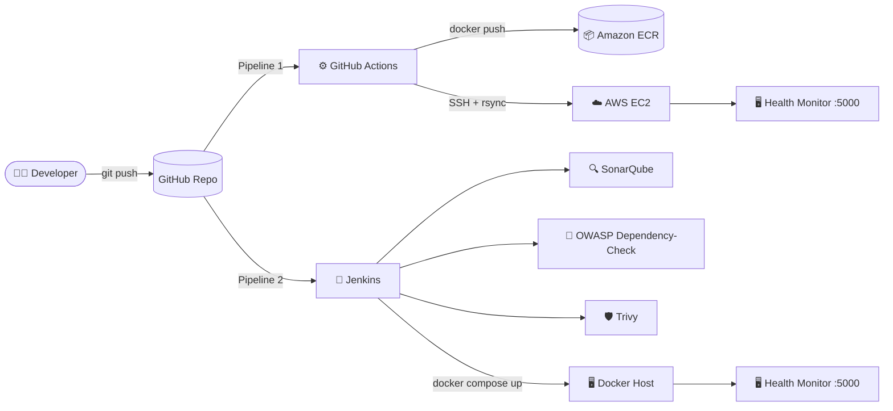
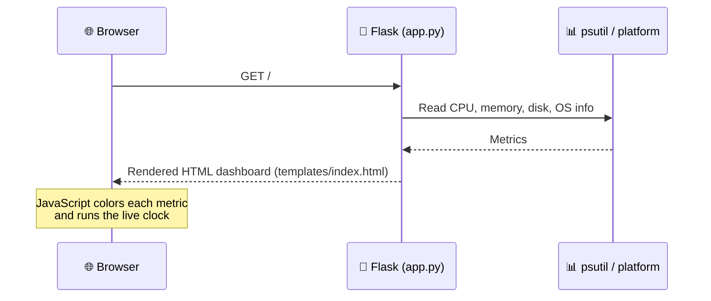
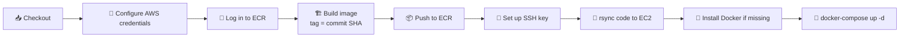
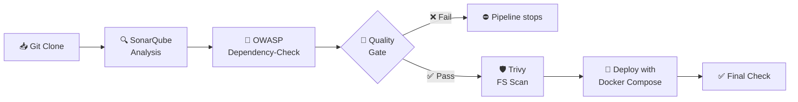

<div align="center">

# 🖥️ System Health Monitor

**A lightweight Flask dashboard for server health, shipped through two production-style CI/CD pipelines with built-in security scanning.**


</div>

---

## 📖 Table of Contents

1. [What This Project Is](#-what-this-project-is)
2. [Features](#-features)
3. [Architecture](#-architecture)
4. [Tech Stack](#-tech-stack)
5. [Project Structure](#-project-structure)
6. [Quick Start](#-quick-start)
7. [CI/CD Pipeline 1: GitHub Actions → AWS](#-cicd-pipeline-1-github-actions--aws)
8. [CI/CD Pipeline 2: Jenkins DevSecOps](#-cicd-pipeline-2-jenkins-devsecops)
9. [Configuration Reference](#-configuration-reference)
10. [Troubleshooting](#-troubleshooting)
11. [What I Learned](#-what-i-learned)
12. [Roadmap](#-roadmap)

---

## 🎯 What This Project Is

This repository has two parts:

1. **The app.** A small Python web dashboard that shows how busy a server is: CPU, memory, disk, operating system, and time.
2. **The delivery system.** Two complete CI/CD pipelines that take that app from a `git push` to a running container on a server, with code quality and security checks along the way.

The app is intentionally simple. **The real focus is the DevOps workflow around it**: containerization, automated deployment to AWS, and a DevSecOps pipeline that scans code, dependencies, and the filesystem before anything ships.

> **New to DevOps?** CI/CD means *Continuous Integration / Continuous Delivery*. Every time code changes, a machine automatically builds, tests, scans, and deploys it, so humans never have to do those steps by hand.

---

## ✨ Features

### The dashboard

| Card | What it shows | Healthy | Warning | Critical |
|---|---|:---:|:---:|:---:|
| 🧠 **CPU Usage** | Current processor load (sampled over 1 second) | < 70% | ≥ 70% | ≥ 90% |
| 💾 **Memory Usage** | RAM in use | < 60% | ≥ 60% | ≥ 85% |
| 🗄️ **Disk Usage** | Space used on the root (`/`) filesystem | < 80% | ≥ 80% | ≥ 95% |
| ℹ️ **System Info** | OS, kernel version, CPU architecture, live clock | | | |

- 🎨 **Traffic-light colors.** Each metric turns green, amber, or red based on the thresholds above.
- 🕒 **Live clock.** It updates every second in the browser.
- 📱 **Responsive glass-style UI.** It works on desktop and mobile.
- 🔄 **Fresh data on every refresh.** Metrics are read from the server each time the page loads.

### The DevOps side

- 🐳 **Containerized** with a slim Python 3.11 image and Docker Compose
- 🚀 **GitHub Actions pipeline** that builds, tags with the commit SHA, pushes to **Amazon ECR**, and deploys to **EC2**
- 🛡️ **Jenkins DevSecOps pipeline** with a **SonarQube** quality gate, **OWASP Dependency-Check**, and **Trivy** scanning
- 🔐 **No secrets in code.** All credentials live in GitHub Secrets or the Jenkins credential store.

---

## 🏗️ Architecture

### Big picture



### How the app works



---

## 🧰 Tech Stack

| Layer | Tools |
|---|---|
| **Application** | Python 3.11, Flask 3.0, psutil 6.0, Jinja2, HTML/CSS/JS |
| **Containers** | Docker, Docker Compose |
| **CI/CD** | GitHub Actions, Jenkins (Declarative Pipeline) |
| **Cloud** | AWS ECR (image registry), AWS EC2 (compute) |
| **Code Quality** | SonarQube with a Quality Gate |
| **Security** | OWASP Dependency-Check (vulnerable libraries), Trivy (filesystem scan) |

---

## 📁 Project Structure

```text
Python-App/
├── .github/
│   └── workflows/
│       └── main.yml              # Pipeline 1: build → push to ECR → deploy to EC2
├── templates/
│   └── index.html                # Dashboard UI (Jinja2 template + CSS + JS)
├── app.py                        # Flask app: collects metrics, renders the page
├── requirements.txt              # Pinned Python dependencies
├── Dockerfile                    # Container image definition
├── docker-compose.yml            # Runs the container on port 5000
├── jenkinsfile.seed              # Pipeline 2: Jenkins DevSecOps pipeline
└── sonar-project.properties      # SonarQube project settings
```

---

## 🚀 Quick Start

### Option A: Run with Docker (recommended)

```bash
git clone https://github.com/abirall/Python-App.git
cd Python-App
docker compose up -d --build
```

Open **http://localhost:5000** 🎉

To stop it:

```bash
docker compose down
```

### Option B: Run with Python directly

```bash
git clone https://github.com/abirall/Python-App.git
cd Python-App
python -m venv venv
source venv/bin/activate        # Windows: venv\Scripts\activate
pip install -r requirements.txt
python app.py
```

Open **http://localhost:5000**

> 💡 **Inside a container, the numbers describe the container's view of the machine.** CPU and memory usually reflect the host, while disk usage reflects the container's filesystem. Run it directly with Python to see your own machine's disk.

---

## ⚙️ CI/CD Pipeline 1: GitHub Actions → AWS

**File:** [`.github/workflows/main.yml`](.github/workflows/main.yml) · **Trigger:** every push to `main`



### What happens, step by step

**Job 1: `build-and-push`**
1. Checks out the code.
2. Signs in to AWS and Amazon ECR.
3. Builds the Docker image and tags it with the **Git commit SHA**, so every image traces back to the exact commit that produced it.
4. Pushes the image to ECR.

**Job 2: `deploy`**
1. Loads the EC2 SSH key from GitHub Secrets.
2. Copies the project to the server with `rsync`, skipping `.git` files.
3. Connects over SSH, **installs Docker and the Compose plugin only if they're missing**, then rebuilds and restarts the container.

### Required GitHub Secrets

Go to **Settings → Secrets and variables → Actions** and add:

| Secret | Example | Purpose |
|---|---|---|
| `AWS_ACCESS_KEY_ID` | `AKIA…` | IAM user with ECR push access |
| `AWS_SECRET_ACCESS_KEY` | `••••••` | Matching secret key |
| `AWS_REGION` | `us-east-1` | Region of your ECR repository |
| `ECR_REPOSITORY` | `python-health-app` | ECR repository name |
| `EC2_HOST` | `3.91.x.x` | Public IP or DNS of the EC2 instance |
| `EC2_USER` | `ubuntu` | SSH user on the instance |
| `EC2_SSH_KEY` | `-----BEGIN…` | Private key for that user |

### EC2 preparation

- Ubuntu instance (a `t2.micro` is enough)
- Security group allows **SSH (22)** from GitHub Actions and **port 5000** for the app
- Docker is installed automatically on the first deploy

---

## 🛡️ CI/CD Pipeline 2: Jenkins DevSecOps

**File:** [`jenkinsfile.seed`](jenkinsfile.seed)

This pipeline adds **shift-left security**: problems are caught before deployment, not after.



| Stage | Tool | What it catches |
|---|---|---|
| **Code Quality Analysis** | SonarQube | Bugs, code smells, security hotspots |
| **Dependency Check** | OWASP Dependency-Check | Libraries with known CVEs |
| **Quality Gate** | SonarQube | Stops the pipeline if quality rules fail (2-minute timeout) |
| **Filesystem Scan** | Trivy | Vulnerabilities and misconfigurations in project files; report saved as `trivy-fs-report.html` |
| **Deploy** | Docker Compose | Starts the app container |

### Jenkins setup

<details>
<summary><b>1. Install the plugins</b></summary>

- SonarQube Scanner
- Docker / Docker Pipeline
- OWASP Dependency-Check (name the installation **`dc`**, install the latest version automatically)

</details>

<details>
<summary><b>2. Run SonarQube</b></summary>

```bash
docker run -d --name sonarqube -p 9000:9000 sonarqube:lts-community
```

Open **http://localhost:9000**. The default login is `admin` / `admin`, and you'll be asked to change it.

</details>

<details>
<summary><b>3. Connect SonarQube and Jenkins</b></summary>

**In SonarQube:**
- **Administration → Security → Users → Tokens:** generate a token named `jenkins`
- **Administration → Configuration → Webhooks:** add `http://<JENKINS_HOST>:8080/sonarqube-webhook/`

**In Jenkins:**
- **Manage Jenkins → Credentials:** add the token as *Secret text*
- **Manage Jenkins → System → SonarQube servers:** Name `Sonar`, URL `http://<SONAR_HOST>:9000`, and select the token
- **Manage Jenkins → Tools → SonarQube Scanner:** Name `Sonar`, check *Install automatically*

</details>

<details>
<summary><b>4. Install Trivy on the Jenkins agent</b></summary>

```bash
sudo apt-get install -y wget apt-transport-https gnupg lsb-release
wget -qO - https://aquasecurity.github.io/trivy-repo/deb/public.key | gpg --dearmor | sudo tee /usr/share/keyrings/trivy.gpg > /dev/null
echo "deb [signed-by=/usr/share/keyrings/trivy.gpg] https://aquasecurity.github.io/trivy-repo/deb $(lsb_release -sc) main" | sudo tee /etc/apt/sources.list.d/trivy.list
sudo apt-get update && sudo apt-get install -y trivy
trivy --version
```

</details>

<details>
<summary><b>5. Create the pipeline job</b></summary>

**New Item → Pipeline →** *Pipeline script from SCM* → Git → `https://github.com/abirall/Python-App.git` → Script Path: `jenkinsfile.seed`

</details>

---

## 🔧 Configuration Reference

| Setting | Value | Where |
|---|---|---|
| App port | `5000` | `app.py`, `Dockerfile`, `docker-compose.yml` |
| Container name | `system-health-app` | `docker-compose.yml` |
| Base image | `python:3.11-slim` | `Dockerfile` |
| SonarQube project key | `health_app` | `sonar-project.properties` |
| Metric thresholds | CPU 70/90, Memory 60/85, Disk 80/95 | `templates/index.html` |

---

## 🩺 Troubleshooting

| Problem | Likely cause | Fix |
|---|---|---|
| `localhost:5000` doesn't load | Container not running or port in use | Run `docker compose ps`, then `docker compose logs` |
| GitHub Actions fails at **Login to ECR** | Wrong AWS secrets or missing IAM permission | Check the secrets; the IAM user needs ECR push rights |
| Deploy step times out | Port 22 closed to GitHub runners | Allow SSH in the EC2 security group |
| Quality Gate never finishes | SonarQube webhook missing or unreachable | Add the Jenkins webhook in SonarQube and check network access between them |
| `trivy: command not found` | Trivy not installed on the agent | Follow setup step 4 |
| Jenkins can't reach SonarQube | Different networks (for example, local PC and EC2) | Run both on the same host or network. This was the fix during development. |

---

## 💡 What I Learned

- **Tag images with the commit SHA.** "Which code is running in production?" becomes a one-line answer.
- **Shift security left.** A failed quality gate in CI costs minutes, while a vulnerability in production costs far more.
- **Networking is half of DevOps.** The hardest bug in this project was Jenkins and SonarQube unable to reach each other across networks, not the code.
- **Make deploys idempotent.** The deploy script installs Docker only when it's missing, so the same pipeline works on a fresh server and on an existing one.

---

## 🗺️ Roadmap

- [ ] Deploy the exact image from ECR on EC2 instead of rebuilding from source
- [ ] Use GitHub OIDC for AWS sign-in instead of long-lived access keys
- [ ] Add a Trivy **image** scan and fail the build on `HIGH`/`CRITICAL` findings
- [ ] Add a `/health` endpoint and a Docker `HEALTHCHECK`
- [ ] Auto-refresh metrics with AJAX instead of page reloads
- [ ] Run with Gunicorn and a non-root user in production
- [ ] Export metrics to Prometheus and Grafana

---

<div align="center">

**Built by [Abir Al Zubayer](https://github.com/abirall)** · DevOps & Cloud Platform Engineer

[🌐 alzubayer.com](https://alzubayer.com) · [💼 LinkedIn](https://www.linkedin.com/in/abir-al-zubayer/) · [✍️ Medium](https://medium.com/@abirall)

⭐ If this helped you, consider giving the repo a star!

</div>
